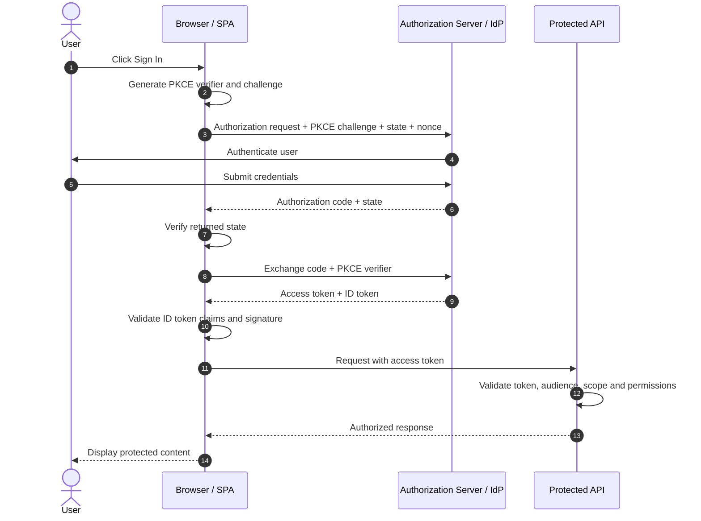

# Authentication and Authorization Flow

## System Overview

This is a proposed security architecture for a fictional
single-page application (SPA). It is separate from the
OWASP WebGoat training environment.

The system uses OAuth 2.0 Authorization Code Flow with
PKCE and OpenID Connect for user authentication.

## Authentication Sequence

## Security Controls

1. PKCE protects authorization-code exchange.
2. State helps prevent authorization response CSRF.
3. OIDC nonce helps bind the ID token to the login request.
4. HTTPS protects authentication traffic.
5. The API validates access-token signatures and claims.
6. Authorization is enforced for every protected resource.
7. Tokens should not be stored in insecure browser storage.
8. Security events should be logged without exposing secrets.

## Trust Boundaries

- Browser to authorization server.
- Browser to protected API.
- Authorization server to token consumer.
- Authenticated user to protected application resources.

## Important Notes

- OAuth 2.0 provides delegated authorization.
- OpenID Connect adds an authentication identity layer.
- JWT is a token format, not an authentication protocol.
- Decoding a JWT does not validate its signature.
- This diagram is a proposed architecture, not an
  implemented OAuth/OIDC deployment.
